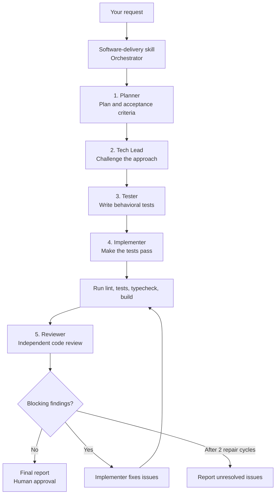
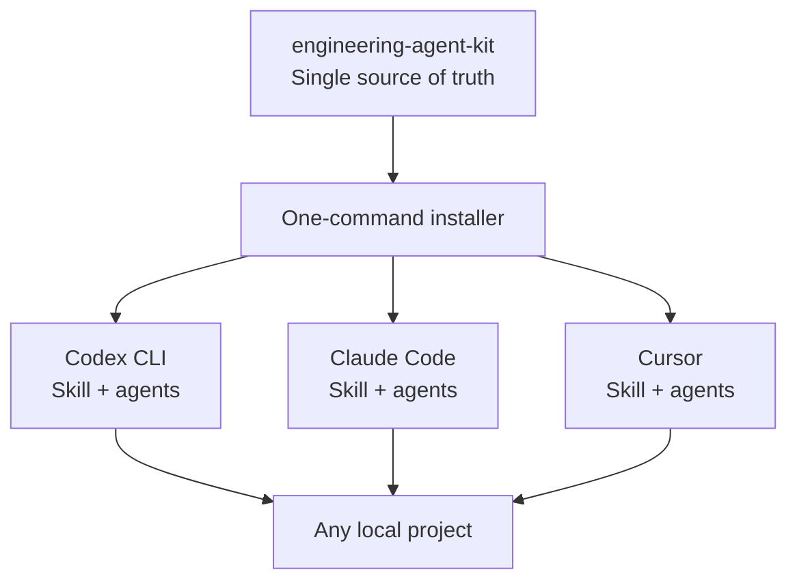

# Engineering Agent Kit

**One reusable development workflow for Codex CLI, Claude Code, and Cursor.**

Install the `software-delivery` skill **and all five native agents** with one command. No manual clone or Python setup required.

## Quick start

### 1. Install for every local project

**Requires Node.js 20+ and Git** (plus Codex CLI, Claude Code, and/or Cursor). The command works in PowerShell, macOS, and Linux:

```bash
npx -y github:craguilar/engineering-agent-kit --scope global
```

Verify the installation:

```bash
npx -y github:craguilar/engineering-agent-kit --scope global --verify
```

This installs the **skill and five native agents** for Codex, Claude Code, and Cursor. `npx` retrieves the kit from GitHub automatically; you do not need to clone it or install Python.

Preview changes without writing files:

```bash
npx -y github:craguilar/engineering-agent-kit --scope global --dry-run
```

**Skill only:** If you do not need the five native subagents, use the Skills CLI instead:

```bash
npx -y skills add craguilar/engineering-agent-kit --skill software-delivery -a codex -a claude-code -a cursor -g -y
```

That separate command installs the shared skill, **not** the native agent definitions.

### 2. Use it in any project

Open your project's directory and **start a new session** with your preferred assistant:

| Tool | Start |
| --- | --- |
| Codex CLI | `codex` |
| Claude Code | `claude` |
| Cursor | Open the project and start an Agent chat |

Then request:

```text
Use the software-delivery skill and the delivery agents to implement
<your feature or bug fix>. Plan first, add tests, implement,
run validation, and get an independent review. Do not push or merge.
```

Claude Code also supports `/software-delivery` to invoke the skill explicitly. In Cursor, use `/software-delivery` if available or mention its name; in Codex, mention the skill and the `delivery-*` agents.

## How the workflow works

The assistant acts as the orchestrator, calling specialized agents in order:



Only the tester and implementer should modify files, **one at a time**. The planner, tech lead, and independent reviewer should not edit code. The workflow stops after two repair iterations and never pushes or merges without approval.

## Share it across projects and teams

The global installation makes the skill and agents available in *all local projects on your computer*:



For **team projects and cloud/CI agents**, install into the current project directory instead:

```bash
cd path/to/your-project
npx -y github:craguilar/engineering-agent-kit --scope project --project .
npx -y github:craguilar/engineering-agent-kit --scope project --project . --verify
```

Commit the installed `.agents/`, `.codex/`, `.claude/`, and `.cursor/` directories to share the workflow with your team. Existing project instructions (`AGENTS.md` and `CLAUDE.md`) are not changed.

## Optional: agent runtime skill

The `agent-runtime` skill is a specification for building production LLM tool-calling agents: a bounded loop, tool registry, code-enforced guards, human approval, sessions, memory, quotas, audit, and offline evals. It is provider-neutral, with Bedrock and OpenAI notes. Its [maturity page](skills/agent-runtime/references/maturity.md) shows which parts have been implemented.

The default installer does **not** include it. Install it separately:

```bash
npx -y skills add craguilar/engineering-agent-kit --skill agent-runtime -a codex -a claude-code -a cursor -g -y
```

## Manage the installation

Use the same `npx -y github:craguilar/engineering-agent-kit` prefix with these options:

| Option | What it does |
| --- | --- |
| `--scope global` | Install for all projects on this computer (default) |
| `--scope project --project .` | Install into the current project |
| `--agents codex` | Install only Codex (or `claude`, `cursor`, or combinations) |
| `--dry-run` | Preview changes without writing anything |
| `--verify` | Check installed files |
| `--force` | Back up and replace changed installed files |

To update: rerun the install command. If it reports different existing files, review them with `--dry-run`, then use `--force` to back up and replace them. To pin a reproducible version in CI, use a Git commit or tag suffix such as `#<commit-sha>` on the GitHub package specifier.

### Alternative: work from a local checkout

If you are contributing to the kit or prefer its Python installer:

```bash
git clone https://github.com/craguilar/engineering-agent-kit.git
cd engineering-agent-kit
python3 scripts/install.py --scope global
```

The Python installer requires **Python 3.11+**. PowerShell users can run `py -3 scripts/install.py --scope global` instead. Both installers deploy the same shared skill and native agents.

For kit development, edit canonical roles in `agents/`, not generated adapters. Validate changes with:

```bash
python3 scripts/render_adapters.py --check
python3 -m unittest discover -s tests -v
npm test
```

## Limitations

This kit installs **instructions and agent definitions**, not a standalone execution server. Each assistant delegates to its own native agents; it does not automatically run Claude Code from Codex or vice versa. Agent definitions do **not** guarantee access isolation (Codex subagents inherit their parent's sandbox). A separate orchestrator is needed for enforced permissions, durable traces, or cross-provider delegation.

See [compatibility and permissions](docs/compatibility.md) and the [workflow contract](skills/software-delivery/references/handoffs.md) for details.
