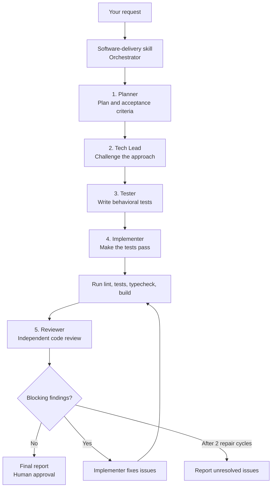
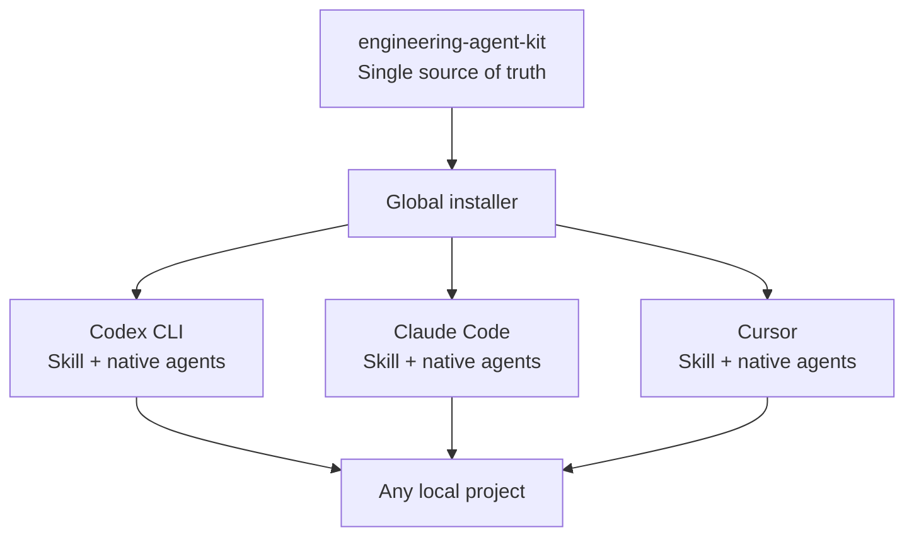

# Engineering Agent Kit

**One reusable software-delivery workflow for Codex CLI, Claude Code, and Cursor.**

Install it once to get the `software-delivery` skill **and five specialized agents**. Use them to plan, test, implement, validate, and review changes in your projects.

## Quick start — no clone required

**Requirements:** Node.js 18+, Python 3.11+, Git, and at least one of Codex CLI, Claude Code, or Cursor.

### 1. Install the complete kit

Run **one command** in PowerShell, macOS Terminal, or Linux:

```bash
npx -y github:craguilar/engineering-agent-kit --scope global
```

This downloads the kit for the installer, then installs the **software-delivery skill and all five native agents** for Codex, Claude Code, and Cursor. You do **not** need to clone the repository or install any Python dependencies.

Check the installation:

```bash
npx -y github:craguilar/engineering-agent-kit --scope global --verify
```

For a safer preview before installing:

```bash
npx -y github:craguilar/engineering-agent-kit --scope global --dry-run
```

**Only want the skill?** The Skills CLI can install just the skill, but it does **not** install this kit's native agent definitions:

```bash
npx -y skills add craguilar/engineering-agent-kit --skill software-delivery -a codex -a claude-code -a cursor -g -y
```

### 2. Use it in any project

Open your project's folder and start a **new** Codex, Claude Code, or Cursor Agent session.

| Tool | How to start |
| --- | --- |
| Codex CLI | Run `codex` in your project |
| Claude Code | Run `claude` in your project |
| Cursor | Open the project and start an Agent chat |

Then ask:

```text
Use the software-delivery skill and its delivery agents to
implement <your feature or bug fix>.

Plan first, write tests, implement, run validation, and
perform an independent review. Do not push or merge.
```

In Claude Code you can also invoke `/software-delivery` directly. In Cursor, use that command if available or mention the skill by name.

## How it works

The coding assistant acts as the **orchestrator** and delegates each phase to a specialized agent.



The tester and implementer edit files **sequentially**. The planner, tech lead, and reviewer are intended to work without modifying code. The reviewer gets a fresh context. The workflow stops after two repair cycles and never pushes or merges without approval.

## Using it across projects

**Global installation** makes the skill and agents available to all projects on *your machine*:



For **team repositories, CI, or cloud agents**, install directly into the project's folder (run from the target project):

```bash
npx -y github:craguilar/engineering-agent-kit --scope project --project .
npx -y github:craguilar/engineering-agent-kit --scope project --project . --verify
```

This writes the skill and agent files into the project's `.agents/`, `.codex/`, `.claude/`, and `.cursor/` folders. It does **not** overwrite the project's `AGENTS.md` or `CLAUDE.md`.

## Useful commands

Append any of these flags to the `npx` installer command:

| Option | Purpose |
| --- | --- |
| `--agents codex` | Install only for Codex; also supports `claude` and `cursor` |
| `--dry-run` | Preview changes |
| `--verify` | Confirm installed files match |
| `--force` | Back up and replace conflicting files |

For example: `npx -y github:craguilar/engineering-agent-kit --scope global --agents codex claude --dry-run`.

### Alternative: install from a local checkout

If you're developing the kit or prefer not to use `npx`, clone it and use the existing installer:

```bash
git clone https://github.com/craguilar/engineering-agent-kit.git
cd engineering-agent-kit
python3 scripts/install.py --scope global
```

On Windows, use `py -3` instead of `python3`.

## Updating the shared workflow

Rerun the `npx` command to get the current kit. Existing files are not overwritten silently: use `--dry-run` to inspect differences and `--force` to back up and replace installed files when you're ready.

If you maintain the kit, edit canonical files in `agents/`, then regenerate adapters and run tests:

```bash
python3 scripts/render_adapters.py --write
python3 scripts/render_adapters.py --check
python3 -m unittest discover -s tests -v
```

## Important limitations

This kit provides **skills and agent definitions**, not a standalone orchestration server. Each coding assistant runs its own native agents; installing the kit does **not** automatically make Codex invoke Claude Code or Cursor. Agent instructions alone do not enforce filesystem permissions (Codex subagents inherit the parent sandbox). For hard isolation or cross-vendor delegation, use a separate orchestrator.

See [compatibility and permissions](docs/compatibility.md) and the [workflow contract](skills/software-delivery/references/handoffs.md) for details.
